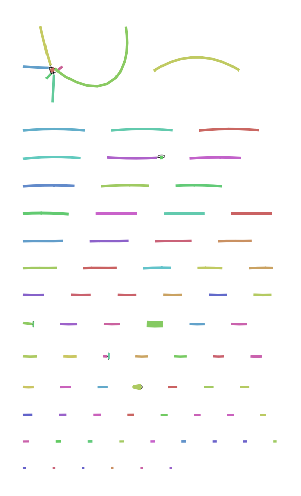
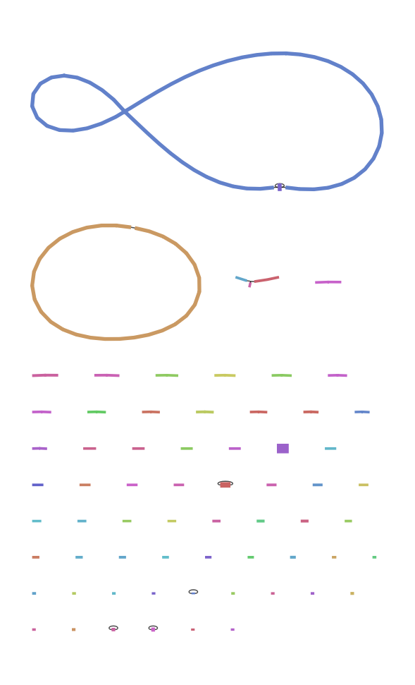
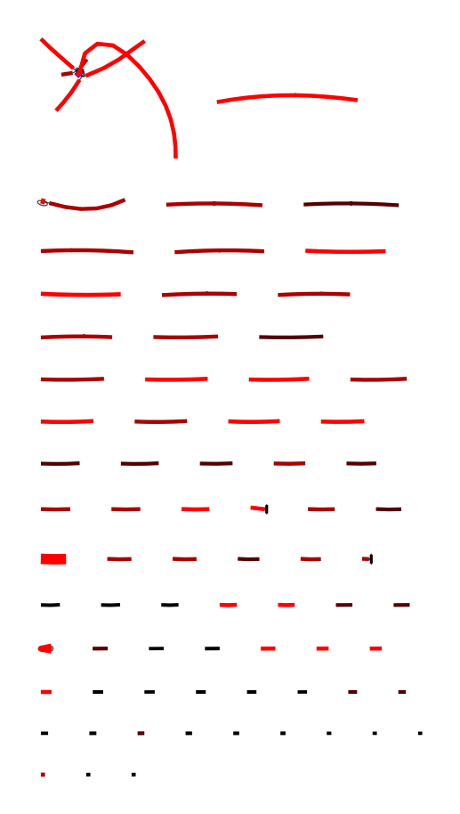

```{r setup, include=FALSE}
knitr::opts_chunk$set(echo = TRUE)
# Bash chunks are a record of commands you ran in the Terminal. Knitting shows
# them but doesn't run them again.
knitr::opts_hooks$set(engine = function(options) {
  if (options$engine == "bash") options$eval <- FALSE
  options
})
```

Notes for [Workshop 2](https://mb5370.bioinformatics.guide/workshop2.html). Run the commands for this workshop in the Terminal, from inside the folder named under each heading. Copy each command you run into a bash chunk.

## Redbean assembly

Commands run in `redbean/`.

### 6x coverage assembly

The initial genome assembly was performed using approximately
6x Oxford Nanopore sequencing coverage.

```{bash, eval=FALSE}
cd ~/mb5370-workshops/redbean
cat /pvol/data/amtp4/*_[012].fastq > amtp4.fastq
wtdbg2 -x ont -g 5m -i amtp4.fastq -fo amtp4_6x -t 4
wtpoa-cns -t 4 -i amtp4_6x.ctg.lay.gz -fo amtp4_6x.ctg.fa
```

**Results:**

- Number of contigs: 129
- Total consensus assembly length: 3,816,923 bp
- Estimated N50: 49,152 bp
- Largest contig (estimated): 162,816 bp

### 20x coverage assembly

The assembly was repeated using all ten sequencing files
to increase sequencing coverage to approximately 20x.

```{bash, eval=FALSE}
cat /pvol/data/amtp4/*_[0-9].fastq > amtp4_20x.fastq
wtdbg2 -x ont -g 5m -i amtp4_20x.fastq -fo amtp4_20x -t 4
wtpoa-cns -t 4 -i amtp4_20x.ctg.lay.gz -fo amtp4_20x.ctg.fa
```

**Results:**

- Number of contigs: 92
- Total consensus assembly length: 7,072,570 bp
- Estimated N50: 1,754,368 bp
- Largest contig (estimated): 3,314,176 bp

### Comparison

Increasing sequencing coverage from approximately 6x to 20x
improved assembly contiguity. The number of contigs decreased
from 129 to 92, while the estimated N50 increased substantially.

The 20× assembly produced fewer contigs and substantially longer assembled sequences than the 6× assembly, suggesting that increased sequencing coverage improved assembly continuity. However, the total assembly length exceeded the expected genome size, indicating that further investigation would be needed to assess assembly accuracy.

## Flye assembly

Commands run in `flye_genome/`.

### 6x coverage assembly

The approximately 6x Oxford Nanopore dataset was assembled
using Flye with an estimated genome size of 5 Mb.

```{bash, eval=FALSE}
cd ~/mb5370-workshops/flye_genome
flye --nano-raw ../redbean/amtp4.fastq --out-dir amtp4_6x --genome-size 5m --threads 4
```

**Results:**

- Total assembly length: 5,174,629 bp
- Number of contigs: 78
- N50: 119,681 bp
- Largest contig: 368,925 bp
- Mean coverage: 7x

### 20x coverage assembly

The assembly was repeated using the higher-coverage dataset.

```{bash, eval=FALSE}
flye --nano-raw ../redbean/amtp4_20x.fastq --out-dir amtp4_20x --genome-size 5m --threads 4
```

**Results:**

- Total assembly length: 7,482,640 bp
- Number of contigs: 54
- N50: 1,775,265 bp
- Largest contig: 3,378,257 bp
- Mean coverage: 20x

### Comparison of Flye assemblies

Increasing sequencing coverage improved assembly contiguity.
The number of contigs decreased from 78 to 54, while N50
increased from approximately 120 kb to 1.78 Mb.

The higher-coverage assembly contained two particularly large
contigs of approximately 3.38 Mb and 1.78 Mb. These may
represent the two chromosomes characteristic of many Vibrio
species, although further investigation is required.

The total assembly length also increased to approximately
7.48 Mb, exceeding the specified genome size of 5 Mb.
Further analysis using QUAST will help assess assembly quality.

### Comparison with Redbean

Flye produced fewer contigs than Redbean at both sequencing
coverage levels, suggesting greater assembly contiguity.

However, fewer contigs do not necessarily indicate a more accurate or complete genome assembly. Both assemblers produced total assembly lengths exceeding the expected genome size at 20× coverage, suggesting that further investigation would be needed to assess assembly accuracy and completeness.

## Assembly graphs with Bandage
### Flye 6× assembly graph



### Flye 20× assembly graph



### Flye 6× assembly graph coloured by sequencing depth



The Flye assembly graphs were visualised using Bandage to compare genome assembly structure at 6× and 20× sequencing coverage.

**6× assembly:** The assembly graph contained 83 nodes and 17 edges, with a total graph length of 5,191,743 bp. The graph was highly fragmented, with numerous disconnected sequences and a branching structure. One node within this structure (`edge_11`) was 5,242 bp long and had a sequencing depth of 43×, substantially higher than the expected 6× coverage. Its elevated depth and multiple connections suggest that it may represent a collapsed repetitive region.

**20× assembly:** The assembly graph contained 67 nodes and 10 edges, with a total graph length of 7,723,165 bp. Two prominent sequences were identified: `edge_15` (3,367,286 bp; 24× depth) and `edge_3` (1,775,265 bp; 23× depth). Their lengths are consistent with the two expected *Vibrio* chromosomes, although their identities have not been independently confirmed. Another sequence, `edge_45` (47,228 bp), had an unusually high depth of 370×, potentially indicating repetitive DNA or a high-copy-number element.

**Comparison:** Increasing sequencing coverage from 6× to 20× substantially improved assembly continuity, producing two large chromosome-sized sequences instead of numerous shorter fragments. Both graphs contained evidence of potentially repetitive regions. However, the differences in their lengths and coverage do not establish whether these regions represent the same genomic sequence.

## Comparison of genome assemblies


### Assembly statistics

| Assembler | Coverage | Contigs | Total assembly length (bp) | N50 (bp) |
|-----------|----------|---------|----------------------------|----------|
| Redbean | 6× | 129 | 3,816,923 | — |
| Redbean | 20× | 92 | 7,072,570 | — |
| Flye | 6× | 78 | 5,174,629 | 119,681 |
| Flye | 20× | 54 | 7,482,640 | 1,775,265 |

